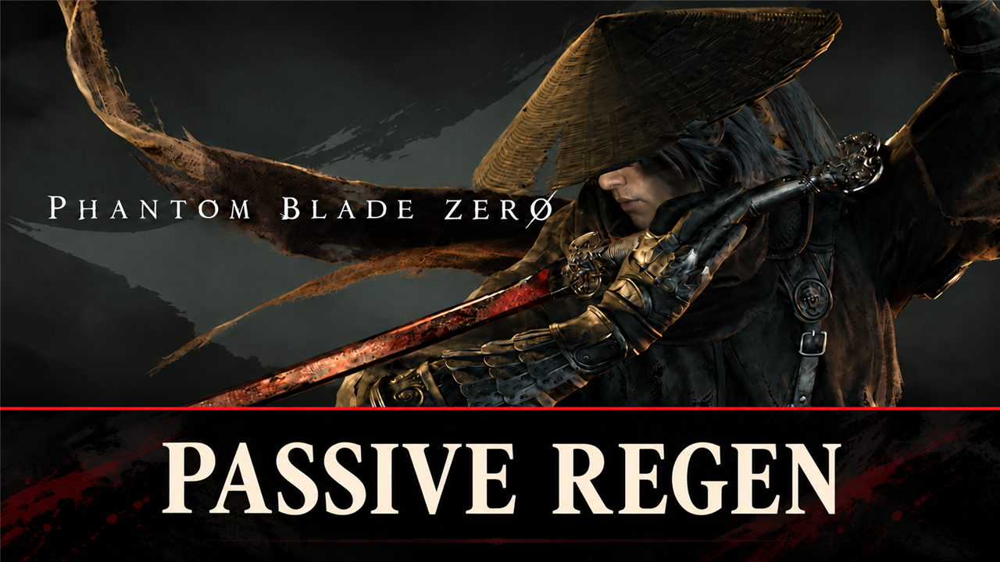

# Passive Regen

Your health regenerates by itself: 1.5% of max health every 2 seconds. The rate and regen in combat are set in config.lua, live in game.

## What it does

Your health comes back by itself: every 2 seconds you get 1.5% of your maximum health, so a full bar takes a little
over 2 minutes.

- The amount is a setting (`PercentPerTick`, 0.1 to 25).
- `InCombat = false` keeps the regen to the time out of combat, for a game where fights stay as hard as they are.
- The health bar shows each step at once.
- Settings change live: edit `config.lua`, save, and the game uses them within a few seconds.

No regen while the game is paused, while you are dead, or at full health.

It is a UE4SS Lua script: it sets your health while the game runs, with the game's own health command. It replaces
no game file and does not touch your save.

## Screenshots

## How to install

1. Install UE4SS for Phantom Blade Zero, for example [UE4SS](https://github.com/KintaroModding/ue4ss) (its zip
   `phantombladezero_ue4ss_<version>.zip`: the official UE4SS build with a config that makes it run in this game).
2. Download the zip of the latest release on GitHub (`phantombladezero_passiveregen_<version>.zip`).
3. Unpack it into the game folder `platform\steam\`, next to the game's exe. It adds the folder
   `ue4ss\Mods\phantombladezero_passiveregen\` (with the file `enabled.txt`, UE4SS starts it by itself).
4. Start the game.

To check that it runs: `platform\steam\ue4ss\UE4SS.log` has the line `[Passive Regen] <version> loaded.`

To update the mod, replace the folder with the one of the new release; to keep your settings, put your old
`Scripts\config.lua` back (a setting that it does not have keeps its default). To remove it, delete the folder
`ue4ss\Mods\phantombladezero_passiveregen\`.

## How to use

Nothing to do: the mod works as soon as you load a game.

## Settings

The settings are in `platform\steam\ue4ss\Mods\phantombladezero_passiveregen\Scripts\config.lua`. Open it with a text
editor, change a value and save: the mod reads the file every 5 seconds, so you see the change in the game without a
restart. A file it cannot read (for example a typo) keeps the last settings. `UE4SS.log` shows the settings in use in
the line `[Passive Regen] Settings: ...`, and names each value it could not use.

| Setting | Default | What it does |
|---|---|---|
| `Enable` | `true` | `false`: no regen, the game as normal |
| `PercentPerTick` | `1.5` | The share of your maximum health you get back every 2 seconds (0.1 to 25) |
| `InCombat` | `true` | `false`: regen only out of combat |
| `LogDetail` | `false` | `true`: `UE4SS.log` names when the regen runs or waits, and every 10th heal (for tests) |

## Compatibility

- Game version: Steam build 26367565 (`CL-302256_JKS-17280`).
- Tested with UE4SS `v3.0.1-1195-g1ceefac8`.
- Other mods that heal you (for example
  [Live by the Blade](https://github.com/KintaroModding/phantombladezero_livebytheblade)) add up with it.

## Known issues

None yet.

## How to build

There is nothing to build: `src\phantombladezero_passiveregen\Scripts\main.lua` is the mod. `tests\test_main.py` runs the script
outside the game with Lua 5.4 ([lupa](https://pypi.org/project/lupa/)) and mocks of UE4SS:
`python tests\test_main.py`. `README.md` has the details.

## Credits

Made by Kintaro. MIT license: you may use, change and share this mod. UE4SS is made by the
[UE4SS-RE team](https://github.com/UE4SS-RE/RE-UE4SS). Phantom Blade Zero belongs to its makers.
